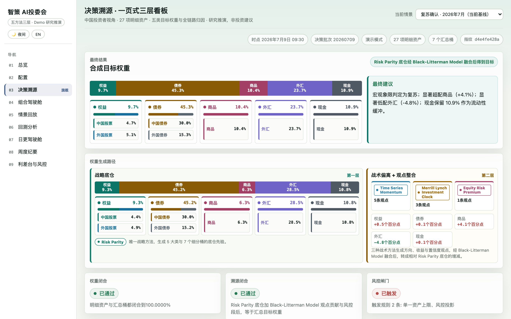
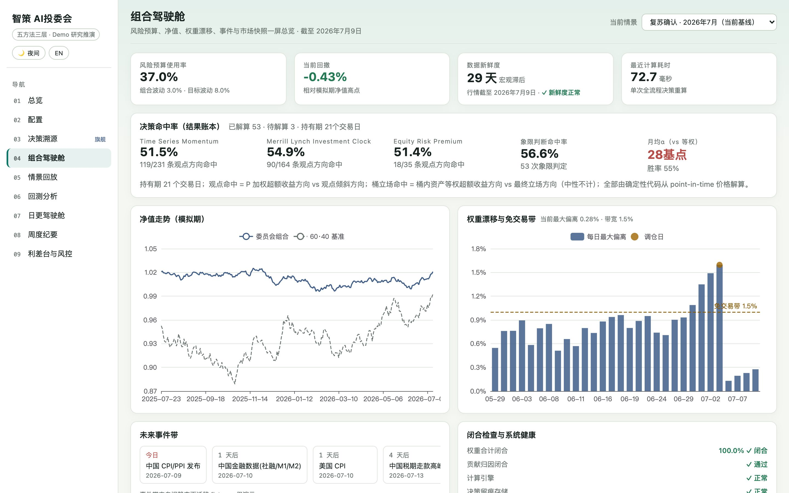
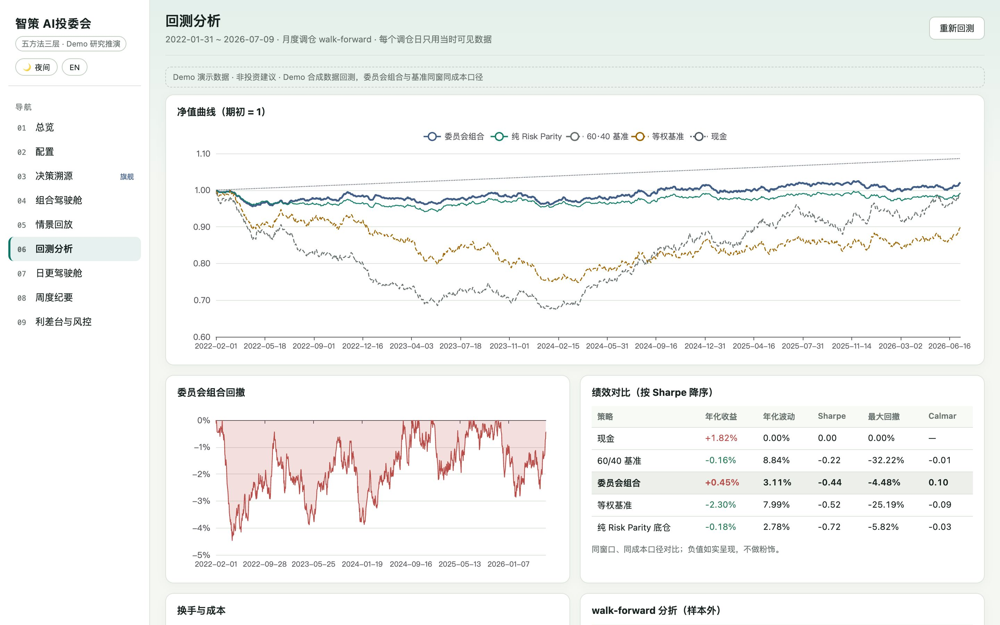

<div align="center">

# AI Investment Committee

**A reproducible asset-allocation demo with traceable signals, views and portfolio weights.**

[Method](#method) · [Quick start](#quick-start) · [Data and safety](#data-and-safety) · [简体中文](README.zh-CN.md)

[](https://github.com/flukier1016/ai-investment-committee/actions/workflows/ci.yml)


</div>

This project implements a three-layer investment committee workflow: a Risk Parity strategic prior, tactical views from momentum, the investment clock and equity risk premium, and Black–Litterman fusion followed by risk constraints. The result can be inspected from inputs and signals through views to final allocations.

**The included data is fixed-seed synthetic demo data.** This is a research and engineering demonstration, not a live investment service or investment advice. The UI supports Chinese and English; the existing default is Chinese and can be switched in the interface.

<p align="center"></p>

## Method

| Layer | Method | Role |
| --- | --- | --- |
| Strategic | Risk Parity | Establishes the strategic prior, risk budgets and within-bucket allocation. |
| Tactical | Time Series Momentum | Produces trend-based views that can abstain when inputs are unsuitable. |
| Tactical | Merrill Lynch Investment Clock | Forms macro views from point-in-time growth and inflation states. |
| Tactical | Equity Risk Premium | Forms relative-value views from equity/bond risk-premium signals. |
| Fusion | Black–Litterman Model | Combines prior and standardized views before deterministic risk projection. |

The trace displays **L1 signals**, **L2 view assembly and fusion**, and **L3 projected weights and attribution**. The allocation is represented as 27 assets, seven buckets and five asset classes. With the same data and configuration fingerprints, the decision ID and weights are reproducible. Contributions and guardrail adjustments reconcile to each bucket target. See [architecture](docs/architecture.md) for the detailed construction rules (Chinese).

## What is included

- A nine-module React interface: overview, configuration, trace, portfolio cockpit, scenarios, backtest, daily cockpit, weekly report and spread desk.
- Decision reports, lineage, view attribution and a decision-outcome ledger.
- Monthly walk-forward backtests and benchmarks using the included synthetic data and documented cost assumptions.
- A command-line interface, FastAPI service and container deployment.
- Experimental model-client infrastructure that is **disabled and disconnected from the decision pipeline by default**. The deterministic engine computes the weights.

<table><tr><td width="50%"></td><td width="50%"></td></tr></table>

## Quick start

Requirements: Python 3.11+, [uv](https://docs.astral.sh/uv/), Git and Node.js 22.12+ (or Node.js 20.19+). Docker is optional.

```bash
git clone https://github.com/flukier1016/ai-investment-committee.git
cd ai-investment-committee
make install
make dev
```

Open the Vite address printed in the terminal, normally `http://localhost:5173/`. The API is at `http://127.0.0.1:8000`, with a health check at `/api/health` and development API docs at `/docs`. Stop both processes with `Ctrl-C`.

For a single local port, build the UI and serve it through FastAPI:

```bash
make build
make backend
```

Then open `http://127.0.0.1:8000/`. Alternatively, with Docker Compose:

```bash
APP_REVISION="$(git rev-parse HEAD)" docker compose up --build -d --wait --wait-timeout 300
curl http://127.0.0.1:8000/api/health
docker compose down
```

The Compose named volume holds local decision records and is retained by `docker compose down`.

## Data and safety

- `data/demo/` contains reproducible synthetic market, macro and scenario inputs. `data/runs/` is ignored local runtime state.
- The development API has no authentication. Use it locally or in a controlled environment, and review deployment controls before exposing it.
- Optional tactical input failures result in explicit abstention; core data failures stop the calculation. Backtests use point-in-time rules but remain demonstrations on synthetic data.
- The default workflow does not call an LLM or require API credentials. Setting a model API key alone does not enable the experimental client.
- Turnover in the risk explanation is a theoretical proxy relative to the strategic prior, not executed trading volume.

## Tests and development

```bash
make test      # backend acceptance tests
make build     # TypeScript check and frontend build
cd frontend && npx playwright install chromium && cd ..
make e2e       # browser interaction tests
```

Playwright may reuse services on ports 8000 and 5173; check that they belong to this project before running it. Other commands include `make data`, `make backend` and `make frontend`. See [architecture](docs/architecture.md), [handoff](docs/HANDOFF.md) and [change history](docs/CHANGELOG.md) for implementation rules, data contracts and tests. These detailed references are currently in Chinese.

## License

[MIT](LICENSE). Contributions and issue reports are welcome.
