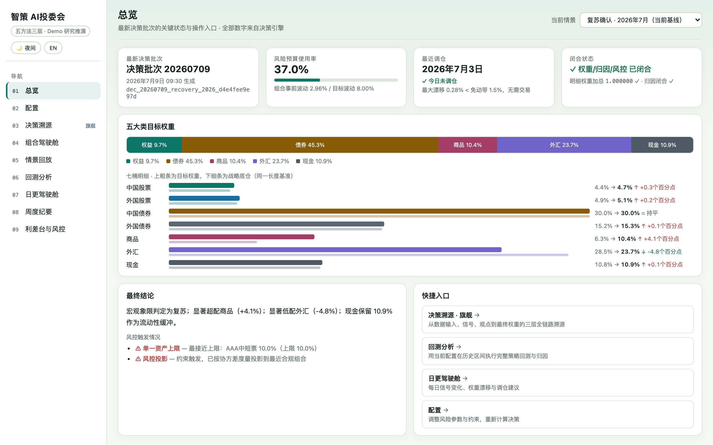
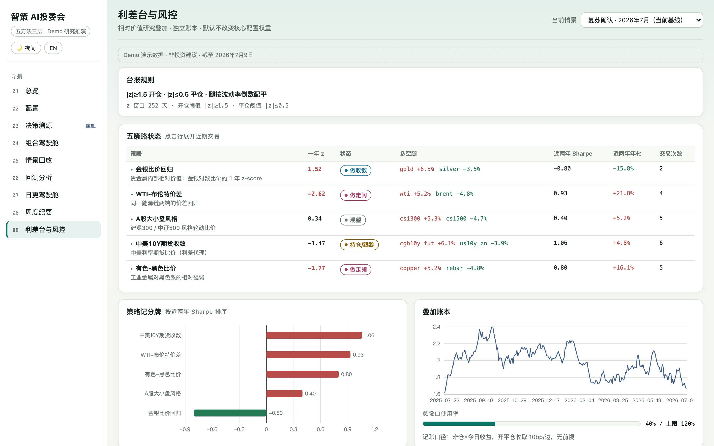
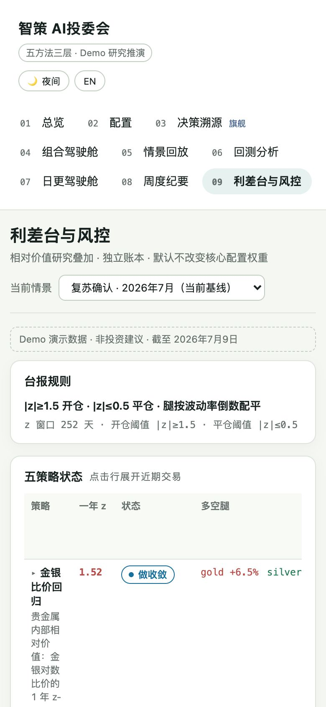

<div align="center">

# 智策 AI 投委会 · AI Investment Committee

**五种方法、三层结构的可运行资产配置决策系统：每个权重都能追溯到数据、信号和观点。**

以 Risk Parity 为战略底仓，Time Series Momentum、Merrill Lynch Investment Clock、Equity Risk Premium 形成战术观点，<br>
再由 Black-Litterman Model 融合，经确定性风控投影得到 27 项明细资产、7 个资产桶与 5 大类权重。

[看一眼](#看一眼) &nbsp;·&nbsp; [五方法三层](#五方法三层) &nbsp;·&nbsp; [快速开始](#五分钟快速开始) &nbsp;·&nbsp; [安全与数据](#安全与数据)

[](https://github.com/flukier1016/ai-investment-committee/actions/workflows/ci.yml)


</div>

<p align="center"></p>

## 为什么做

投委会讨论资产配置时，最难的往往不是给出一组权重，而是说清楚**每个权重从哪里来、改一个假设会怎样**。
这个系统把五种经典方法放进三层结构，所有数字由代码确定性计算：相同输入得到相同 `decision_id` 和相同权重；
从宏观信号、观点贡献到风控投影，每一步都能在“决策溯源”里展开查看。另外提供决策纪要、结果账本、回测、命令行和 Docker 单服务部署。

> 只使用固定种子的合成 Demo 数据，用于研究推演与工程演示，不构成投资建议。

## 看一眼

<table>
<tr>
<td width="50%"><br><sub><b>总览</b>：最新决策批次、风险预算使用率、五大类与七桶目标权重、风控触发</sub></td>
<td width="50%"><br><sub><b>组合驾驶舱</b>：权重、观点和风险贡献放在一屏对照</sub></td>
</tr>
<tr>
<td width="50%"><br><sub><b>回测分析</b>：月度调仓 walk-forward，只用当时可见数据；与 60/40、等权、纯 Risk Parity 同窗同成本对比</sub></td>
<td width="50%"><br><sub><b>利差台与风控</b>：利差监控与风控闸门的触发情况</sub></td>
</tr>
</table>

<p align="center"><br><sub>手机端同样可用；中英文、日间夜间可切换</sub></p>


## 五方法三层

| 方法 | 职责 | 层级 |
|---|---|---|
| Risk Parity | 唯一战略底仓：风险预算、桶内逆波动率和约束投影 | 战略 |
| Time Series Momentum | 以多周期价格趋势形成方向明确、可弃权的战术信号 | 战术 |
| Merrill Lynch Investment Clock | 以 point-in-time 增长与通胀状态形成宏观象限观点 | 战术 |
| Equity Risk Premium | 以股债风险溢价分位形成相对价值观点 | 战术 |
| Black-Litterman Model | 将战略先验与标准化观点融合为后验收益及权重贡献 | 融合 |

三层溯源口径：

1. **L1 信号层**：四个上游方法输出带来源和输入哈希的信号。
2. **L2 融合层**：观点统一装配为 `P / Q / Ω`，由 Black-Litterman Model 融合。
3. **L3 权重层**：风控投影后的目标权重、五档立场、逐观点归因与护栏动作。

### 不可破坏的确定性承诺

- 所有数字由确定性代码计算；模型只能输出枚举、置信度档位或叙事。
- 相同数据指纹和配置指纹必须生成相同 `decision_id`。
- 27 项明细资产、7 个资产桶、5 大类权重分别严格加总为 1。
- 每桶满足 `prior + Σ观点贡献 + guardrail = target` 的预算中性闭合。
- `Q` 锚定先验隐含收益 `π`；观点方向与最终贡献方向一致；单观点倾斜执行
  Idzorek 式截断。
- 核心数据失败会中止；可选战术输入失败只允许显式 `abstain`，不得自由文本回退。
- 所有持久化写入使用唯一临时名和 `os.replace`，避免并发半写。

完整构造纪律见 [docs/architecture.md](docs/architecture.md)。

## 九个前端模块

| # | 路由 | 模块 | 说明 |
|---|---|---|---|
| 01 | `/overview` | 总览 | 最新决策、五大类权重、闭合状态与快捷入口 |
| 02 | `/config` | 配置 | 账户、风险、执行和模型参数；投资性格只透明映射风险参数 |
| 03 | `/trace` | **决策溯源（旗舰）** | 三层同屏、血缘抽屉、27 列 P 矩阵、计算流水线与逐条复核 |
| 04 | `/cockpit` | 组合驾驶舱 | 市场快照、净值、漂移、数据新鲜度和闭合检查 |
| 05 | `/scenarios` | 情景回放 | 双情景 as-of 重算对比，防未来数据泄漏 |
| 06 | `/backtest` | 回测分析 | 月度 walk-forward，委员会与四基准同窗同成本比较 |
| 07 | `/daily` | 日更驾驶舱 | 理想权重与持仓漂移，免交易带触发调仓 |
| 08 | `/weekly` | 周度纪要 | 从 DecisionRecord 结构化生成周度 Markdown |
| 09 | `/spread-desk` | 利差台与风控 | 5 个相对价值策略独立叠加，默认不改变核心权重 |

界面支持日间/夜间主题、中英双语与移动端。用户可见的方法名只使用上表英文
全称；行情与收益遵循红涨绿跌。普通 UI 颜色只来自 CSS 变量，ECharts 颜色统一
使用 `frontend/src/meta.ts` 的 `SOLID` 常量。

## 已实现的审计与投委会能力

- **五档立场**：目标权重相对 Risk Parity 先验的差值统一映射为显著超配、超配、
  中性、低配、显著低配。阈值为 ±0.4 个百分点与 ±2 个百分点，周报、前端和
  结果账本共用同一函数。
- **确定性决策纪要**：`GET /api/decisions/{id}/report` 导出摘要、三层权重、
  逐观点参数与归因、护栏及血缘索引。
- **委员会正反检验**：质疑与回应由规则从 DecisionRecord 抽取，可回跳到观点、
  信号和输入哈希，不使用自由文本模型辩论。
- **风控三视角**：激进、保守、中性分别解释波动预算利用率、距上限余量和换手
  相称性。换手是目标相对战略先验的理论代理，不是实际成交。
- **决策结果账本**：维护 pending → resolved 生命周期，统计观点方向、桶立场、
  宏观象限命中率与相对基准收益。
- **新闻时点契约**：未来新闻始终不可见；回测对无时间新闻 fail-closed，live
  可保留无时间新闻。当前只有过滤契约和 Demo fixture，尚未接入真实新闻源或
  决策链。
- **可追溯命令行与 Docker**：无需 HTTP 即可运行、回测、下钻和导出，也可用
  非 root 单容器复现完整应用。

里程碑与验收测试索引见 [docs/CHANGELOG.md](docs/CHANGELOG.md)。

## 五分钟快速开始

### 环境要求

- Python 3.11 或更高版本
- [uv](https://docs.astral.sh/uv/)
- Node.js 22.12 或更高版本（Vite 也支持 Node.js 20.19+；CI 与 Docker 使用 22）
- Git
- Docker Engine/Desktop + Compose V2（仅 Docker 运行需要）

### 安装并启动

```bash
git clone https://github.com/flukier1016/ai-investment-committee.git
cd ai-investment-committee
make install
make dev
```

`make dev` 同时启动后端和前端；以终端里 Vite 输出的 `Local` 地址为准：

- 前端：`http://localhost:5173/`，根路径默认进入 `/trace`
- API 健康检查：`http://127.0.0.1:8000/api/health`
- Swagger：`http://127.0.0.1:8000/docs`

另开终端验证后端：

```bash
curl http://127.0.0.1:8000/api/health
# 预期：{"status":"ok","mode":"demo"}
```

在运行 `make dev` 的终端按 `Ctrl-C`，会同时停止两个服务。

### 单端口本地运行

先构建前端，再由 FastAPI 在 8000 端口同时托管 API 与静态页面：

```bash
make build
make backend
```

打开 `http://127.0.0.1:8000/`。注意：`make build` 只生成 `frontend/dist`，不会
自行启动服务。

<details>
<summary><b>端口冲突与旧应用排障</b></summary>

如果 5173 打开的不是本项目，先检查监听者：

```bash
lsof -nP -iTCP:5173 -sTCP:LISTEN
lsof -nP -iTCP:8000 -sTCP:LISTEN
```

- 有监听进程：确认它属于哪个项目，再停止该进程或换一个前端端口。
- 没有监听进程，但浏览器仍显示旧应用：通常是该 origin 遗留的 Service Worker
  或 Cache Storage。打开浏览器 DevTools → Application → Service Workers，执行
  `Unregister`；再到 Storage 清除站点数据并硬刷新。
- `localhost` 可能解析为 IPv6 `::1`；遇到连接或缓存混淆时，使用明确的
  `127.0.0.1` 与全新端口。

推荐的全新前端 origin 启动方式：

```bash
# 终端 1：仓库根目录，后端继续使用 8000
make backend
```

```bash
# 终端 2：仓库根目录
cd frontend
npm run dev -- --host 127.0.0.1 --port 5188 --strictPort
```

打开 `http://127.0.0.1:5188/`。前端的相对 `/api` 请求仍由 Vite 代理到 8000，
无需修改代码。开发态后端端口应保持 8000；当前代理配置没有运行时端口覆盖项。

</details>

<details>
<summary><b>Docker 一键复现</b></summary>

```bash
APP_REVISION="$(git rev-parse HEAD)" \
  docker compose up --build -d --wait --wait-timeout 300
curl http://127.0.0.1:8000/api/health
```

打开 `http://127.0.0.1:8000/`。镜像以 UID/GID `10001` 非 root 运行、根文件系统
只读，只把决策记录和派生缓存写入 `decision-runs` 命名卷。

```bash
docker compose exec committee id -u
docker compose exec committee invest run
docker compose down
```

`docker compose down` 保留命名卷；只有明确要删除全部 Docker 决策记录时才使用
`docker compose down -v`。修改宿主机映射端口：

```bash
APP_REVISION="$(git rev-parse HEAD)" PORT=8080 \
  docker compose up --build -d --wait --wait-timeout 300
```

此时打开 `http://127.0.0.1:8080/`。

完整容器烟测：

```bash
RUN_DOCKER_SMOKE=1 \
  uv run --project backend pytest tests/backend/test_docker.py -q
```

</details>

## 安全与数据

- **只用合成数据**：`data/demo/` 是固定种子生成的合成行情、宏观、风险溢价与情景，CI 会逐字节验证可复现；仓库里没有任何授权数据。
- **仓库里没有密钥**：实验性大模型基建默认关闭，不读取 API Key、不发模型请求；需要时只从环境变量读取，Key 不进仓库。
- **开发 API 没有认证**：只应在本机或受控环境运行；本地决策与账本写在被 Git 忽略的 `data/runs/`。
  公网演示部署另有两道防护：计算类 POST（决策运行、回测）限流，同一来源 10 分钟最多 60 次、全站每小时最多 600 次，超限返回 429；决策记录最多保留 1000 份，超出后淘汰最早的记录（均可用环境变量 `AIC_POST_LIMIT_PER_CLIENT`、`AIC_POST_LIMIT_PER_HOUR`、`AIC_MAX_DECISION_RECORDS` 调整）。
- **模型永远不能输出权重**：即使将来接入大模型，结构化输出也只允许预定义象限、置信度、引用与叙事，失败统一降级为 `abstain`。


<details>
<summary><b>Demo 数据与本地状态</b></summary>

| 路径 | 生命周期 |
|---|---|
| `data/demo/` | 固定种子的合成行情、宏观、风险溢价与情景；受 Git 管理 |
| `data/demo/legacy/` | 从旧静态页迁移的展示 fixture，不是当前引擎数字来源 |
| `data/runs/` | 本地决策、结果账本和派生缓存；被 Git 忽略，可由引擎重算 |
| `data/runs/llm_traces/` | 实验性模型调用 trace；默认决策路径不会生成 |

重新生成 Demo 数据：

```bash
make data
git diff -- data/demo
```

固定种子重建后应无差异；CI 会逐字节验证。要重置本地运行状态，应先停止服务，
再清理 `data/runs/`；不要删除 `data/demo/`。

</details>

<details>
<summary><b>实验性大模型基建（默认关闭）</b></summary>

当前只有客户端契约、三 provider 注册表、本地 mock 测试与内容寻址 trace：

- 固定三类：`openai_compatible`、`deepseek`、`ollama`；不接受任意 `base_url`。
- 默认 `make install` 不安装或导入 OpenAI SDK，不读取 API key，也不发模型请求。
- 没有 UI、CLI 或公开 API 开关；设置 `OPENAI_API_KEY` 或 `DEEPSEEK_API_KEY`
  本身不会启用模型。
- 模型客户端没有接入真实新闻、信号、Black-Litterman Model 或权重链；
  DecisionRecord 的 `llm_traces` 在默认路径保持为空。
- 结构化输出只允许预定义象限、置信度档位、引用与叙事；失败统一降级为
  `abstain`，模型永远不能输出权重、收益率或 `Ω`。
- trace 使用私有权限、唯一临时名和 `os.replace`；相同调用只重放通过身份、
  schema、摘要和引用白名单校验的结构化结果。

只有开发客户端基建时才安装可选 SDK：

```bash
cd backend
uv sync --extra llm
uv run pytest ../tests/backend/test_llm_foundation.py -q
```

设计与官方兼容面说明见 [docs/architecture.md](docs/architecture.md)。

</details>

## 开发者参考


<details>
<summary><b>API 速查</b></summary>

完整交互文档位于 `http://127.0.0.1:8000/docs`，固定响应样例位于
[docs/api_samples](docs/api_samples/)。

```bash
curl -X POST http://127.0.0.1:8000/api/decisions/run \
  -H 'Content-Type: application/json' \
  -d '{"scenario_id":"recovery_2026"}'
```

| 方法与路径 | 用途 |
|---|---|
| `GET /api/health` | 健康检查与运行模式 |
| `GET /api/meta` | 资产宇宙、情景、方法和数据区间 |
| `GET /api/config/defaults` | 默认配置与投资性格映射 |
| `POST /api/decisions/run` | 运行并原子保存一次确定性决策 |
| `GET /api/decisions` | 已保存决策索引 |
| `GET /api/decisions/{id}` | 前端消费的完整决策 bundle |
| `GET /api/decisions/{id}/record` | 原始不可变 DecisionRecord |
| `GET /api/decisions/{id}/report` | 确定性 Markdown 决策纪要 |
| `GET /api/overview` | 总览页聚合数据 |
| `GET /api/cockpit` | 组合驾驶舱聚合数据 |
| `POST /api/backtest/run` | walk-forward 回测 |
| `GET /api/daily` | 日更与免交易带状态 |
| `GET /api/weekly-report` | 周度结构化纪要 |
| `GET /api/spread-desk` | 利差台独立账本与核心护栏 |
| `GET /api/outcomes` | 决策结果账本；`backfill=true` 可回填历史 |
| `GET /api/scenarios/compare` | 两个 point-in-time 情景对比 |

公开请求不能启用实验性模型客户端，也不能借用服务器密钥。API 当前无认证、限流
或租户隔离，只适合本地 Demo。

</details>

<details>
<summary><b>命令行</b></summary>

安装依赖后，可以从仓库根目录直调确定性引擎：

```bash
uv run --project backend invest run
uv run --project backend invest run --scenario stagflation_2022 --asof 2022-10-14
uv run --project backend invest backtest
uv run --project backend invest trace DECISION_ID
uv run --project backend invest trace DECISION_ID --view VIEW_ID
uv run --project backend invest report DECISION_ID > decision.md
```

可用情景：`recovery_2026`、`stagflation_2022`、`overheat_2025`。

`run` 会原子落库并维护结果账本；`trace` 沿“七桶归因 → 观点 → 信号 → 输入
哈希”下钻；`report` 输出由同一 DecisionRecord 确定性生成的 Markdown。

</details>

<details>
<summary><b>端到端计算链路</b></summary>

```text
Demo 输入（合成行情 / point-in-time 宏观 / Equity Risk Premium 输入）
  → as-of 切片 + SHA-256 输入指纹
  → 协方差（对数收益 + 线性收缩）
  → Risk Parity 战略底仓（风险预算 + 桶内逆波动率 + 约束投影）
  → Time Series Momentum / Merrill Lynch Investment Clock /
    Equity Risk Premium 战术信号（无效输入显式弃权）
  → 观点标准化：P 腿归一；Q = P·π + 信号倾斜；Ω = (1−c)/c·3τ·PΣPᵀ
  → Black-Litterman Model：π = δΣw_prior；方向纪律；Idzorek 倾斜上限
  → CVXPY 风控投影（long-only / 单资产与桶上限 / 债券底仓 / 波动预算）
  → 27 明细资产 → 7 桶 → 5 大类（严格闭合）
  → 归因：prior + Σ观点段 + guardrail = target
  → 不可变 DecisionRecord（输入指纹幂等）
```

</details>

<details>
<summary><b>测试与 CI 门禁</b></summary>

首次运行 Playwright 前安装 Chromium：

```bash
cd frontend
npx playwright install chromium
cd ..
```

Linux/CI 使用 `npx playwright install --with-deps chromium`。

本地三道交付门禁：

```bash
make test      # 后端 pytest
make build     # TypeScript 检查 + Vite 构建
make e2e       # Playwright，自动拉起前后端
```

附加检查：

```bash
(cd frontend && npm run lint)
(cd backend && uv lock --check)
```

Playwright 配置会复用已经监听 8000/5173 的服务。运行 `make e2e` 前应确认这两个
端口没有其他项目，否则测试可能复用错误应用；备用的 5188 端口只用于人工查看，
不会改变 Playwright 内置的 5173 web server。

GitHub Actions 有三个必须全绿的 job：

1. **后端验收测试**：pytest、错误级 Ruff、Docker 一键复现烟测。
2. **确定性承诺**：Demo 数据逐字节重建、相同输入重放一致。
3. **前端构建与交互测试**：TypeScript/Vite 构建、Playwright。

</details>

<details>
<summary><b>仓库目录</b></summary>

```text
backend/app/domain     信号、融合、优化、风控、回测、日更、利差台
backend/app/api        FastAPI 路由
backend/app/cli.py     run / backtest / trace / report 命令行
backend/app/llm        三 provider 注册表、惰性 client、内容寻址 trace
backend/app/schemas    TracedSignal / View / DecisionRecord / Config 契约
backend/app/services   落库、bundle、委员会、结果账本、纪要与周报
frontend/src           React + TypeScript + Vite + ECharts 九模块前端
frontend/e2e           Playwright 交互防线
data/demo              确定性合成数据与情景
data/runs              Git 忽略的本地运行状态
tests/backend          后端验收与一文件一防线测试
docs                   架构、交接、变更日志、样例与权威规格
Dockerfile             Node 构建 → Python slim 非 root 单服务镜像
compose.yaml           环回端口、健康检查、只读根与命名卷
```

</details>

<details>
<summary><b>文档索引</b></summary>

- [架构与构造纪律](docs/architecture.md)
- [项目交接、铁律与任务地图](docs/HANDOFF.md)
- [可验收里程碑变更日志](docs/CHANGELOG.md)
- [API 固定响应样例](docs/api_samples/)
- [旧数据迁移说明](docs/data_migration.md)
- [五方法三层权威规格](docs/reference/AI资产配置投委会_五方法三层_AgentSKILL_V3.md)
- [三层溯源前端交接规范](docs/reference/AI前端实现交接_三层溯源看板.md)

</details>

<details>
<summary><b>开发纪律</b></summary>

1. 修改引擎前先读 `docs/HANDOFF.md` 与 `docs/architecture.md` 的构造纪律。
2. 一次只交付一项能力，并沿用“一文件一防线”的测试风格。
3. DecisionRecord 新字段必须有默认值，保证旧记录仍可加载。
4. 前端不重算后端数字；新字符串必须进入 i18n；普通 UI 颜色使用 CSS 变量，
   ECharts 颜色统一使用 `frontend/src/meta.ts` 的 `SOLID` 常量。
5. 用户可见方法名只使用五个英文全称；红涨绿跌。
6. 功能或修复同步更新 `docs/CHANGELOG.md`，并引用真实验收测试名。
7. 提交前依次通过 pytest、前端构建、Playwright；使用中文 commit，push 后确认
   GitHub Actions 三个 job 全绿。
8. 只向本仓库 `flukier1016/ai-investment-committee` 提交；不要修改旧仓库
   `flukier1016/asset-allocation-kb`。

</details>

## 许可

[MIT](LICENSE)。本项目只做研究推演与工程演示，不构成任何投资建议。
