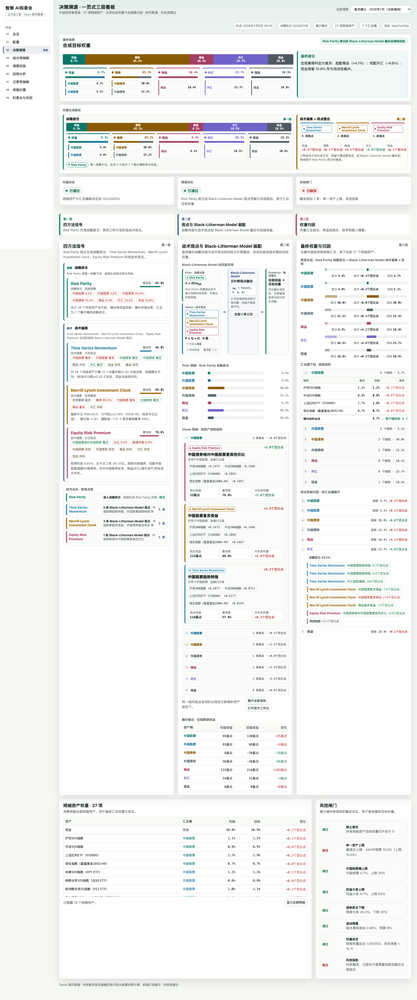

# 智策 AI 投委会 · AI Investment Committee

> 五方法三层的可运行资产配置决策系统 Demo：**Risk Parity 唯一战略底仓 + Time Series
> Momentum / Merrill Lynch Investment Clock / Equity Risk Premium 战术观点 +
> Black-Litterman Model 整合**。全部数字由确定性代码计算、全链路可追溯、可回放。
>
> Demo 合成数据 · 研究推演 · 非投资建议。



## 快速开始

```bash
make install   # backend: uv sync；frontend: npm install
make dev       # 后端 http://localhost:8000 · 前端 http://localhost:5173
make test      # 后端完整验收测试
make e2e       # Playwright 交互测试（自动拉起前后端）
make build     # 构建 frontend/dist（后端同端口托管，单进程部署）
```

依赖：Python ≥3.11 + [uv](https://docs.astral.sh/uv/)、Node ≥20。

## 命令行

`make install` 后可以不启动 HTTP 服务，直接调用确定性引擎：

```bash
cd backend
uv run invest run
uv run invest run --scenario stagflation_2022 --asof 2022-10-14
uv run invest backtest
uv run invest trace DECISION_ID
uv run invest trace DECISION_ID --view VIEW_ID
uv run invest report DECISION_ID
```

`run` 会原子落库并维护结果账本；`trace` 按“七桶归因 → 观点 → 信号 →
输入哈希”下钻；`report` 把第二项的确定性 Markdown 原样写到标准输出。

## 九个模块

| # | 模块 | 说明 |
|---|---|---|
| 01 | 总览 | 最新决策批次、五大类权重、闭合状态、快捷入口 |
| 02 | 配置 | 账户/风险/执行/模型参数，「重新计算」触发完整链路；投资性格问卷只透明映射风险参数 |
| 03 | **决策溯源（旗舰）** | 一页式三层看板：L1 四方法信号 → L2 Black-Litterman 装配 → L3 权重归因；血缘抽屉 + 双页签技术工作台（27 列 P 矩阵 / 四步计算流水线 + 议案逐条复核） |
| 04 | 组合驾驶舱 | 市场快照、净值、权重漂移、数据新鲜度、闭合检查 |
| 05 | 情景回放 | 双情景 as-of 重算对比，point-in-time 防未来数据泄漏 |
| 06 | 回测分析 | 月度调仓 walk-forward，委员会 vs 四基准同窗同成本口径 |
| 07 | 日更驾驶舱 | 每日理想权重 vs 持仓，免交易带触发调仓 |
| 08 | 周度纪要 | 由本周 DecisionRecord 结构化生成，Markdown 导出 |
| 09 | 利差台与风控 | 5 个相对价值策略独立叠加账本，默认不改核心权重 |

界面支持**日间/夜间主题**与**中/英双语**切换（导航栏左上角）；引擎生成的叙事文本保持中文。

另有两项投委会特色机制（借鉴 TradingAgents 后做的确定性改造，详见
[docs/architecture.md](docs/architecture.md)）：**决策-结果闭环账本**
（逐观点方向命中率、象限命中率、月均 α，`GET /api/outcomes`）与
**委员会正反检验**（质疑/回应论据由规则从决策记录抽取、可回跳血缘）。
单次不可变决策还可通过 `GET /api/decisions/{id}/report` 导出确定性 Markdown
纪要，包含三层权重、逐观点参数与归因、护栏及完整血缘索引。

## 端到端计算链路

```
Demo 输入（合成行情 / point-in-time 宏观 / ERP 输入）
  → as-of 切片 + sha256 输入指纹
  → 协方差（对数收益 + 线性收缩）
  → Risk Parity 战略底仓（四大类风险预算 ERC + 桶内逆波动率 + 约束式投影）
  → TSMOM / Clock / ERP 战术信号（无效资产显式弃权）
  → 观点标准化：P 腿归一 · Q = P·π + 信号倾斜 · Ω = (1−c)/c·3τ·PΣPᵀ
  → Black-Litterman：π = δΣw_RP · He-Litterman λ + 方向纪律 + Idzorek 倾斜上限
  → CVXPY 风控投影（long-only / 单资产与桶上限 / 债券底仓 / 波动预算）
  → 27 明细资产 → 7 桶 → 5 大类（严格闭合）
  → 归因：prior + Σ观点段 + 风控段 = target
  → 不可变 DecisionRecord（输入指纹幂等，相同输入相同结果）
```

LLM 不参与任何数字生成。详细架构与构造纪律见 [docs/architecture.md](docs/architecture.md)。

## 目录

```
backend/app/domain    信号、Black-Litterman、优化、风控、回测、日更、利差台
backend/app/api       FastAPI 端点（交互文档 /docs）
backend/app/cli.py    Typer 命令行（run / backtest / trace / report）
backend/app/schemas   Pydantic 契约（TracedSignal / View / DecisionRecord / Config）
backend/app/services  DecisionRecord 存储 / bundle 组装 / 决策纪要 / 周报
frontend/src          React + Vite + TS + ECharts，9 页面 + 主题/i18n
data/demo             确定性合成数据与情景（scripts/generate_demo_data.py 固定种子）
data/demo/legacy      旧静态页迁移 fixture（见 docs/data_migration.md）
tests/backend         后端验收与 API/CLI 防线；frontend/e2e Playwright
docs/reference        权威规格：Agent Skill V3 · 前端交接 · 三层 mock
```

## 溯源与验收

任一最终权重可追：`桶目标 → attribution[bucket][view_id] → bl_inputs.views[view_id]
→ source_signal_ids → signals_by_id[...].inputs/hash`。核心验收（27 资产/7 桶/5 大类
闭合、P/Q/Ω 一致性、归因闭合、确定性、防未来泄漏、前后端一致）在
`tests/backend/test_acceptance.py` 逐项对应。
